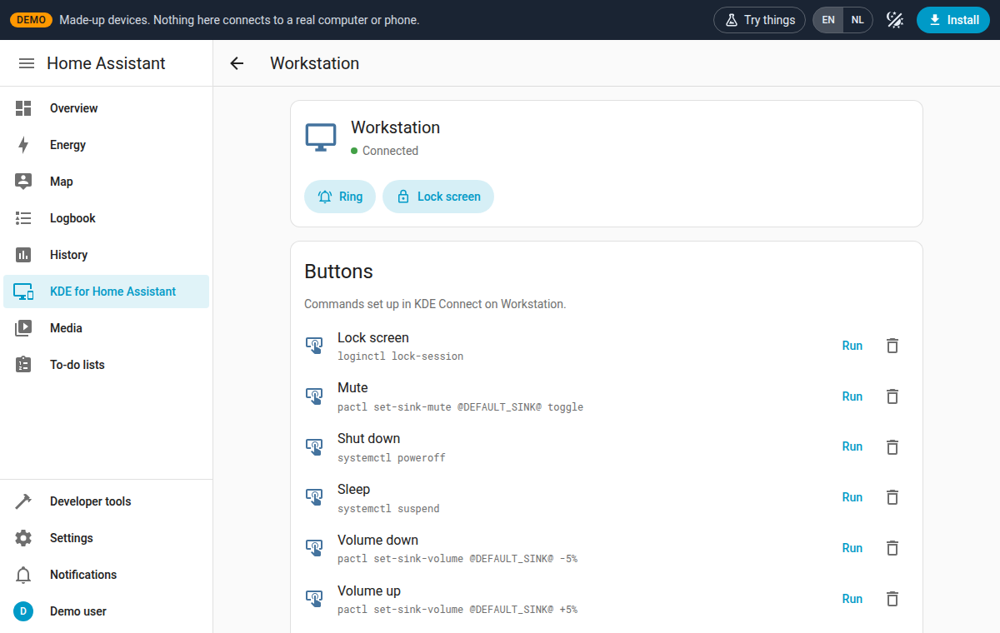

<p align="center"></p>

# KDE for Home Assistant

This integration connects Home Assistant to your computers and phones through [KDE Connect](https://kdeconnect.kde.org/), an open-source app for linking devices on your network. Home Assistant joins the network as a regular KDE Connect device, so your devices only need the normal app.

You can use it to:

- Wake a computer and unlock its screen when you get home.
- Show a notification on your phone or desktop.
- Control the music or volume of a computer from a dashboard.
- Use a computer or TV box from Home Assistant with a remote, touchpad, and keyboard.
- Start a Home Assistant script from the KDE Connect app.

<p align="center">
  <a href="https://radeaus.github.io/kdeforhomeassistant/"></a>
</p>

[](https://radeaus.github.io/kdeforhomeassistant/)

The [demo](https://radeaus.github.io/kdeforhomeassistant/) is the real sidebar page with made-up devices. It needs no Home Assistant or KDE Connect and connects to nothing.

## Supported devices

Any device that runs KDE Connect 23.08 or newer. What the remote can do depends on the device:

- **Linux** (KDE Plasma, Plasma Bigscreen, GNOME with GSConnect, X11 desktops): keys, text, and mouse.
- **Windows and macOS**: keys, text, and mouse.
- **Android and Android TV**: clicks, scrolling, and the Android buttons. Keys work only while the KDE Connect keyboard is active.

## Prerequisites

1. Install [KDE Connect](https://kdeconnect.kde.org/download.html) on each computer or phone.
2. Put those devices on the same network as Home Assistant, with UDP port 1716 and TCP ports 1716-1764 open between them. IPv4 and IPv6 both work.

Home Assistant and the devices find each other with a UDP broadcast over IPv4, and with mDNS (the `_kdeconnect._udp` service) over IPv4 and IPv6. With Home Assistant Container, use host networking, because neither crosses the Docker network.

## Installation

1. Search for **KDE for Home Assistant** in the Marketplace and download it.
<!-- ha-marketplace:exclude-start -->
   Or open it in your Home Assistant directly:

   [](https://my.home-assistant.io/redirect/hacs_repository/?owner=Radeaus&repository=kdeforhomeassistant&category=integration)

   Without the Marketplace: copy `custom_components/kdeforhomeassistant` into your `custom_components` folder.
<!-- ha-marketplace:exclude-end -->
2. Restart Home Assistant if it asks you to.

## Configuration

1. Go to **Settings** > **Devices & services** > **Add integration** and select **KDE for Home Assistant**. Your devices now see Home Assistant as "_your home name_ - Home Assistant".
2. Open **KDE for Home Assistant** in the sidebar and select **Add device**. The wizard walks you through naming Home Assistant, choosing the device, accepting the pairing request, and picking buttons, scripts, and Wake-on-LAN.
3. Repeat step 2 for every other computer or phone.

You can also select **Pair** in KDE Connect on the device. Home Assistant shows the request in the sidebar and as a notification. Accept it within 30 seconds.

Coming from [bartv2/kde_connect](https://github.com/bartv2/kde_connect)? Both integrations use the same ports, so only one can run. Step 1 asks whether to disable or remove the older one, and offers to take over its pairings so your devices stay paired.

## Configuration options

- **Name**: the name your devices show for Home Assistant. Change it under **Configure** on the integration, or **Settings** on the sidebar page. During setup it is asked only when you take over pairings.
- **Device**: when pairing, a KDE Connect device found on your network.
- **Host**: when pairing, the IP address (IPv4 or IPv6) or hostname of a device that is not found.
- **MAC address**: per device, needed for Wake-on-LAN. Leave it empty to hide the **Wake up** button.
- **Scripts the device can run**: per device, the Home Assistant scripts that show up under **Run command** in KDE Connect.

Change the last two under **Change device settings** or on the sidebar page.

## Supported functionality

Each paired device gets these entities, if it offers the feature:

- **Connected** (binary sensor): whether the device is connected.
- **Screen** (lock): locks or unlocks the screen and shows its state.
- Notify entity, named after the device: shows a notification with a title and message.
- **Notification** (event): a notification the device shares with Home Assistant was added, updated, or removed. See [Notifications from devices](#notifications-from-devices).
- **Media** (media player): shows what plays, with title, artist, album, and position. Controls play, pause, stop, next, previous, seek, the active player, and the volume. Mute works when the device shares its system volume.
- **Remote** (remote): sends keys, text, and mouse actions. Turning it on wakes the device.
- **Keyboard** (text): types what you enter on the device, up to 255 characters.
- **Screen** (image): the latest screenshot of the device.
- **Ring** (button): plays the find-my-device sound.
- **Wake up** (button): sends a Wake-on-LAN packet. Needs a MAC address.
- A button per run command, named after it: runs a command set up in KDE Connect on the device.

### Sidebar page

Per device, you can run and add commands, remove a command button or bring it back, share scripts, set the MAC address, and remove the device.

**Remote** opens arrow buttons, a touchpad (tap to select), and a text field. The first time, the device may ask for permission: a "remote control" prompt on Plasma and GNOME (Wayland), the Accessibility permission on macOS, or the KDE Connect accessibility service on Android.

On a computer, **Help me make buttons** writes a prompt for any AI chat from your Linux distribution and the buttons you want. The answer can include a file to load with **Import** under **Run commands** in KDE Connect. Importing replaces the commands already there.

### Screen

Home Assistant can show a screenshot of a computer, which you refresh by hand. The computer takes it with a run command and sends it through KDE Connect.

1. On the sidebar page, open **Remote** and pick the desktop under **Screen**. The page shows the command to add, using the screenshot tool of KDE Plasma or Cinnamon.
2. On the computer, go to KDE Connect > **Run command** and add it as a command named `Screenshot` or `Schermafbeelding`.
3. Select **Refresh** in the remote, or press the **Screenshot** button entity.

### Notifications from devices

Phones and computers can share their notifications with Home Assistant through KDE Connect. Sharing is off until you turn it on per device.

1. In KDE Connect on the device, turn on notification sync for Home Assistant. On Android, open Home Assistant in KDE Connect, go to **Plugin settings** > **Notification sync**, and allow notification access. On Linux, enable **Send notifications** for Home Assistant.
2. On the sidebar page, open the device and turn on **Share notifications** under **Notifications**.
3. Each app shows up under **Apps** after its first notification. Turn apps on or off per device. If the same app sends notifications from your phone and your computer, turn it off on one of them. **Share apps not seen before** sets what happens with new apps.

Silent notifications are skipped unless you turn on **Include silent notifications**.

Every shared notification fires a `kdeforhomeassistant_notification` event and updates the **Notification** entity of the device:

| Field | Description |
| --- | --- |
| `action` | `added`, `updated`, or `removed` |
| `device_id`, `device_name` | The Home Assistant device it came from |
| `id` | The id of the notification on the device, or a chat id for joined chat messages |
| `source_id` | The id on the device, when chat messages are joined |
| `app`, `title`, `text`, `ticker` | The content. A `removed` event only has `app` |
| `silent` | Whether the device posted it silently |
| `icon_url` | The image of the notification, when the device sent one |

On a computer, chat apps such as Telegram, Signal, Discord, and WhatsApp send one notification per message. Messages from the same app and chat are joined into one notification: each new message updates it and is added to its text. The text starts again after five minutes without messages.

Good to know:

- When notification sync is on, the device sends every notification to Home Assistant. Home Assistant drops the ones you don't share, but remembers the app names so you can choose them.
- The text of shared notifications ends up in the history of Home Assistant, through the **Notification** entity.
- An `icon_url` has a random token and works without login, so a display can download it. Home Assistant keeps the last 64 images, in memory.

### Replace ring and screen lock

These don't work on every desktop, Cinnamon for example. A run command with one of these names takes over the built-in function:

- `Ring` or `Laten rinkelen`
- `Lock screen` or `Scherm vergrendelen`
- `Unlock screen` or `Scherm ontgrendelen`

## Actions

The integration adds no actions, triggers, or conditions of its own. Use the standard actions on its entities:

- `notify.send_message`: shows a notification.
- `text.set_value`: types text on the device.
- `lock.lock` and `lock.unlock`: lock or unlock the screen.
- `button.press`: rings the device, wakes it, or runs a command.
- `media_player.*`: playback, seek, volume, mute, and `select_source` to choose the player.
- `remote.turn_on`: wakes the device.
- `remote.send_command`: sends one or more commands, with optional `num_repeats` and `delay_secs`.

Commands for `remote.send_command`:

- `up`, `down`, `left`, `right`, `select`, `back`, `home`, `close`: the buttons of the remote in the KDE Connect app. `home` is the Super key, `close` is Alt+F4.
- `enter`, `escape`, `tab`, `backspace`, `delete`, `page_up`, `page_down`, `home_key`, `end`, `super`, `f1` to `f12`: single keys.
- `a`, `7`, `?`: any single character.
- `ctrl+c`, `alt+f4`, `ctrl+shift+t`: combinations with `ctrl`, `alt`, `shift`, and `super`.
- `text:Hello`: types text.
- `click`, `double_click`, `right_click`, `middle_click`: mouse buttons.
- `android_back`, `android_home`, `android_recents`: Android buttons.
- `scroll_up`, `scroll_down`, `scroll_left`, `scroll_right`: scroll a step. `scroll_down:120` scrolls further.
- `move:50,0`: moves the pointer by `dx,dy`.

An action on a device that is not connected fails with "_device_ is not connected to Home Assistant".

## Examples

Wake a computer, wait for it to connect, and unlock it:

```yaml
sequence:
  - action: button.press
    target:
      entity_id: button.my_pc_wake_up
  - wait_for_trigger:
      - trigger: state
        entity_id: binary_sensor.my_pc_connected
        to: "on"
    timeout: "00:03:00"
  - action: lock.unlock
    target:
      entity_id: lock.my_pc_screen
```

Show a notification on your phone when the front door opens:

```yaml
triggers:
  - trigger: state
    entity_id: binary_sensor.front_door
    to: "on"
actions:
  - action: notify.send_message
    target:
      entity_id: notify.my_phone
    data:
      title: Front door
      message: The front door just opened.
```

## Data updates

Devices push changes to Home Assistant over the local network, so nothing is polled. While a device is disconnected, Home Assistant announces itself every 30 seconds so the device can connect again. A screenshot only updates when you request one.

## Known limitations

- Home Assistant cannot turn a device off, and `remote.turn_off` fails. Use a run command instead.
- The screen is a screenshot, not live video. It works on KDE Plasma and Cinnamon only. GNOME, Xfce, MATE, Windows, and macOS are not supported yet.
- Home Assistant accepts only pictures that a device shares (PNG, JPEG, or WebP, up to 25 MB). It keeps only the latest one, in memory.
- Album art shows when the player shares a web address for it, a local picture (PNG, JPEG, or WebP, up to 5 MB), or the picture itself.
- Wake-on-LAN must be turned on for the device itself. It uses IPv4, and so does finding the MAC address of a device, so neither works on a network with only IPv6.

## Troubleshooting

### KDE for Home Assistant is missing from the sidebar

The page is shown to administrators only. Restart Home Assistant after installing and reload the browser page. If it is still missing, check for an error under **Settings** > **Devices & services** > **KDE for Home Assistant**.

### "Could not open the KDE Connect network ports"

Another program uses port 1716, usually the older [bartv2/kde_connect](https://github.com/bartv2/kde_connect) integration. Go to **Settings** > **Repairs** and choose to disable or remove it. KDE for Home Assistant then starts by itself.

### The device does not connect

Check that KDE Connect is running on the device, and that the device can reach Home Assistant on TCP ports 1716-1764. If the device is not found, enter its address under **Host**.

### A repair says a device is no longer paired

The device removed its pairing. Delete the device from the integration and pair it again.

If you report a problem, add the diagnostics from the integration's menu to [a new issue](https://github.com/Radeaus/kdeforhomeassistant/issues). Certificates, keys, and MAC addresses are left out.

## Removing the integration

To remove one device, open it on the sidebar page and select **Remove**. This also removes the pairing on the device. If you delete it under **Settings** > **Devices & services** instead, also select **Unpair** in KDE Connect on the device.

To remove the whole integration:

1. Go to **Settings** > **Devices & services** > **KDE for Home Assistant**, open the menu (⋮), and select **Delete**.
2. Remove it in the Marketplace and restart Home Assistant.
3. On each device, select **Unpair** in KDE Connect. Home Assistant stays in the list until you do.

## Credits

Inspired by [bartv2/kde_connect](https://github.com/bartv2/kde_connect), the original KDE Connect integration for Home Assistant by [bartv2](https://github.com/bartv2). Its approach of letting Home Assistant join the network as a KDE Connect device is where this project started.

Thanks to the [KDE Connect](https://kdeconnect.kde.org/) team for the app and protocol this builds on.

## License

MIT
