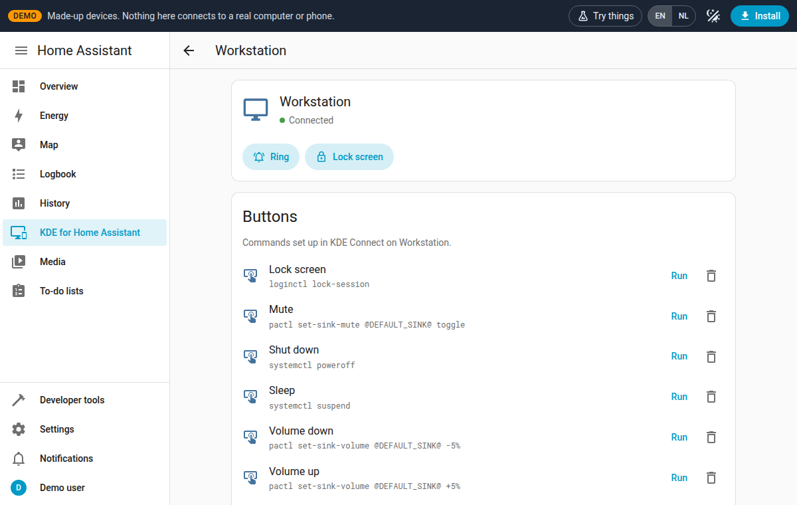

<p align="center"></p>

# KDE for Home Assistant

A Home Assistant integration that speaks the [KDE Connect](https://kdeconnect.kde.org/) protocol. Home Assistant joins your network as a regular KDE Connect device, so your PCs and phones only need the normal KDE Connect app.

<p align="center">
  <a href="https://radeaus.github.io/kdeforhomeassistant/"></a>
</p>

**[Try the demo](https://radeaus.github.io/kdeforhomeassistant/)** before you install. It is the real sidebar page with made-up devices, so you can click through the setup wizard, pair a device, run commands and lock a screen without Home Assistant or KDE Connect. Nothing in the demo connects to a real device.

[](https://radeaus.github.io/kdeforhomeassistant/)

## Getting started

You need KDE Connect 23.08 or newer on each computer or phone, on the same network as Home Assistant (UDP 1716 and TCP 1716–1764 open between them).

1. **Install the integration.** In HACS, open the menu (⋮) > **Custom repositories**, add `https://github.com/Radeaus/kdeforhomeassistant` with type *Integration*, then search for **KDE for Home Assistant** and download it.
   Without HACS: copy `custom_components/kdeforhomeassistant` into your `custom_components` folder.
2. **Restart Home Assistant.**
3. **Add the integration.** Go to **Settings > Devices & services > Add integration** and choose **KDE for Home Assistant**. Home Assistant now shows up on your network as "*your home name* - Home Assistant".
4. **Add a device.** Open **KDE for Home Assistant** in the sidebar and select **Add device**. The wizard walks you through it: name Home Assistant, open KDE Connect on the device, choose the device, accept the pairing request, then pick buttons, scripts and Wake-on-LAN.
5. **Repeat step 4** for every other computer or phone.

Coming from [bartv2/kde_connect](https://github.com/bartv2/kde_connect)? Remove that integration first (both use the same ports). Step 3 then offers to take over its pairings.

You can also select **Pair** in KDE Connect on the device. Home Assistant shows the request in the sidebar and as a notification; accept it within 30 seconds.

## Entities

Per paired device:

| Entity | |
| --- | --- |
| `binary_sensor` Connected | Device is connected |
| `lock` Screen | Lock/unlock the screen, shows lock state |
| `notify` | Send a notification |
| `media_player` Media | What plays on the device (Spotify, a browser, …): play/pause, next/previous, seek, choose the player, and set or mute the system volume |
| `button` Ring | Find-my-device sound |
| `button` Wake up | Wake-on-LAN (needs a MAC address) |
| `button` per run command | Runs the commands configured in KDE Connect on the device |

Home Assistant scripts can be shared with a device and then show up under *Run command* in KDE Connect. The sidebar page lets you manage each device later: run and add commands, share scripts, set the MAC address, or remove it.

## Tips

- **Not sure which commands to use?** On a computer's page, select **Help me make buttons**. Pick your Linux distribution and the buttons you want; the page writes a prompt for any AI chat. The answer can include a file to load with *Import* under *Run commands* in KDE Connect (this replaces the commands already there).
- **Ring or screen lock not working?** They don't on every desktop (Cinnamon, for example). A run command named **Lock screen**, **Unlock screen** or **Ring** (or Dutch: *Scherm vergrendelen*, *Scherm ontgrendelen*, *Laten rinkelen*) takes over that button and the lock entity.

## Troubleshooting

- **No "KDE for Home Assistant" in the sidebar?** The page is only shown to administrators. Restart Home Assistant after installing, and reload the browser page. If it is still missing, open **Settings > Devices & services > KDE for Home Assistant** and check for an error there.
- **"Could not open the KDE Connect network ports"?** Another program uses port 1716, usually the older [bartv2/kde_connect](https://github.com/bartv2/kde_connect) integration. Remove that integration, restart Home Assistant, and the sidebar page shows up.
- **Asked to pick an area for some devices?** Those are the computers and phones that are paired, for example the ones taken over from the older integration. Pick a room, or skip it.
- **Devices show the wrong name for Home Assistant?** Change it on the sidebar page under *Settings*, or with **Configure** on the integration. When you take over pairings, the old name is kept.

## Example

Wake a PC, wait for it to connect, unlock it:

```yaml
sequence:
  - action: button.press
    target:
      entity_id: button.my_pc_wake_up
  - wait_for_trigger:
      - trigger: state
        entity_id: binary_sensor.my_pc_connected
        to: "on"
    timeout: "00:03:00"
  - action: lock.unlock
    target:
      entity_id: lock.my_pc_screen
```

## Credits

Inspired by [bartv2/kde_connect](https://github.com/bartv2/kde_connect), the original KDE Connect integration for Home Assistant by [bartv2](https://github.com/bartv2). Its approach of letting Home Assistant join the network as a KDE Connect device is where this project started.

Thanks to the [KDE Connect](https://kdeconnect.kde.org/) team for the app and protocol this builds on.

## License

MIT
